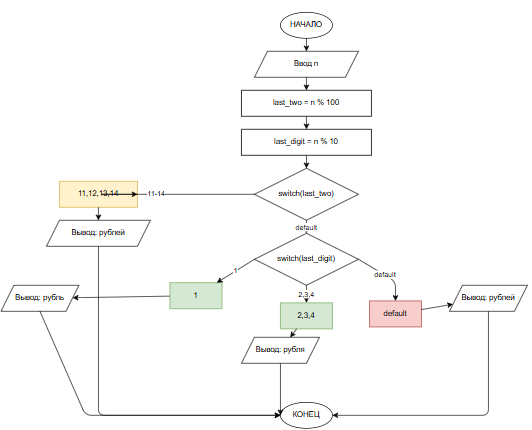

# Домашнее задание к работе 7

## Условие задачи
**Написать программу, которая после введённого с клавиатуры числа (в диапазоне от 1 до 999), обозначающего денежную единицу, дописывает слово "рубль" в правильной форме. Например: 12 рублей, 21 рубль и т.д. Использовать конструкцию if-else не рекомендуется — применять оператор switch.**

---

## 1. Алгоритм и блок-схема

### Алгоритм

1. **Начало**
2. **Ввод данных:**
   - Считать целое число n (1 ≤ n ≤ 999)
3. **Вычисление остатков:**
   - last_two = n % 100 (последние две цифры)
   - last_digit = n % 10 (последняя цифра)
4. **Первый switch (по last_two):**
   - Если last_two ∈ {11, 12, 13, 14} → вывести "рублей" и завершить
   - Иначе → перейти ко второму switch
5. **Второй switch (по last_digit):**
   - Если last_digit = 1 → вывести "рубль"
   - Если last_digit ∈ {2, 3, 4} → вывести "рубля"
   - default (0, 5, 6, 7, 8, 9) → вывести "рублей"
6. **Конец**

### Блок-схема
 
## 2. Реализация программы

```c
int TaskDZ() {
    int n;

    printf("Введите сумму (1-999): ");
    scanf("%d", &n);

    if (n < 1 || n > 999) {
        printf("Число должно быть в диапазоне от 1 до 999\n");
        return 1;
    }

    int last_digit = n % 10;
    int last_two_digits = n % 100;

    printf("%d ", n);
    switch (last_two_digits) {
    case 11:
    case 12:
    case 13:
    case 14:
        printf("рублей\n");
        break;
    default:
        switch (last_digit) {
        case 1:
            printf("рубль\n");
            break;
        case 2:
        case 3:
        case 4:
            printf("рубля\n");
            break;
        default:
            printf("рублей\n");
            break;
        }
        break;
    }

    return 0;
}
```
## 3. Результаты работы программы
Введите сумму (1-999): 331
331 рубль
## 4. Информация о разработчике
Тухватулин Евгений Романович, бТИИ-261
